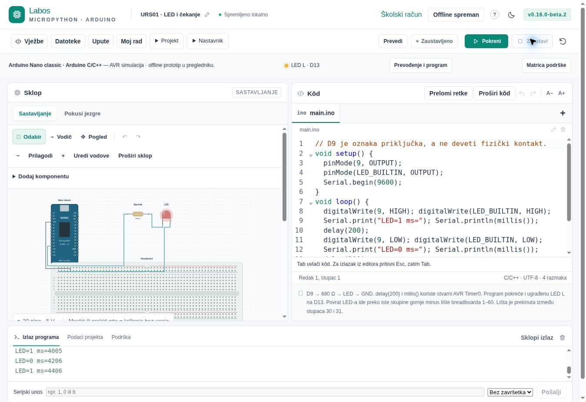

# Arduino offline: odziv i rad nakon ponovnog otvaranja

Prijava: kartica se zamrzne nakon pokretanja prevođenja za klasični Nano u Chromeu na iPhoneu. Fizički iPhone nije dostupan za izravnu reprodukciju; prolazak Linux WebKit testa nije potvrda tog uređaja.

## Promjena

- Svaki alat radi u zasebnom radnom procesu koji se gasi po završetku koraka. Ne učitavaju se svi prevoditelji unaprijed.
- Datotečni sustav alata dobiva samo potrebne ulaze, biblioteke i ciljnu varijantu.
- Prozor aplikacije čita i provjerava spremljene datoteke. ArrayBufferi se prenose radnim procesima bez kopiranja. Samo prevođenje ostaje u radnom procesu.
- Prikazuju se trenutačni korak i proteklo vrijeme. Dostupni su prekid i ograničenje od 60 sekundi; zastarjeli rezultat ostaje blokiran.
- Projektni format, identitet binarnog paketa, izvori i licence ostaju isti.

## Dijagnostika

U WebKitu je nakon zatvaranja i otvaranja preglednika bez mreže zabilježen zastoj pri čitanju spremljene datoteke iz kratkotrajnog radnog procesa. Jednostavni test roditeljskog i podređenog procesa iz offline predmemorije prošao je, pa samo učitavanje skripte procesa nije dovoljno objašnjenje. Premještanje svih provjerenih čitanja u prozor aplikacije prošlo je prevođenje, izvođenje, ponovni restart i drugo prevođenje.

Odvojeno su popravljena dva problema testnog okruženja: blokirani HTTP port 4190 zamijenjen je portom 4173; za WebKit se ne koristi neispravna Playwright emulacija offline načina. Obvezna izolacija operacijskog sustava i dalje vrijedi za oba preglednika: nema poslužitelja ni aktivnog mrežnog sučelja. Izolacija se programski provjerava.

Ispravljena je i utrka paralelnih Node testova pri stvaranju zajedničkih adaptera alata, atomskom zamjenom datoteke.

## Dokazi

- [WebKit dijagnostika 44666403471](https://github.com/zljix/labosv2/actions/runs/44666403471): uspješno prevođenje i simulacija za Nano, prekid i ponovni pokušaj, novi izvor bez mreže, odbacivanje pogrešnog izvora, izvoz/uvoz, potpuni restart i još jedno prevođenje. Najveći razmak odziva mjerenog u testu: 98 ms; to nije mjerenje fizičkog mobitela.
- Lokalno: 6 testova stvarnih odvojenih procesa i prijenosa datoteka, 9 testova integracije te TypeScript provjera uspješni. Oštećeni JS i WASM odbijeni su prije izvršavanja.
- [Završna provjera i objava 44666662390](https://github.com/zljix/labosv2/actions/runs/44666662390): build i deploy uspješni. Objavljena verzija 0.16.0-beta.2, build `3b12f1b1dbd75c83`, izvorni commit `178d00f9889e87002fbe3f2678ec239e0c12406d`. Oba preglednika prošla su nadogradnju s 0.16.0-beta.1 bez brisanja podataka, novo prevođenje u mrežnoj izolaciji i restart. Sačuvana su oba testna projekta i kontrolni sadržaj nepovezane predmemorije. Najveći izmjereni razmak odziva: Chromium 120,2 ms, WebKit 202 ms. Skup prevoditelj/projekti/simulacija: 116 prolazaka, 0 padova, 4 ranije uvjetno preskočena testa zasebnog lokalnog Arduino CLI mosta. Testovi offline WASM puta izvršeni su.

Nema pouzdane brojčane tvrdnje o postotku smanjenja memorije: lokalni uzorci vršne potrošnje varirali su. Za konačnu potvrdu prijave potreban je ponovni pokušaj na korisnikovu iPhoneu s objavljenom beta.2.

## Provjera javne objave

Javni manifest potvrđen je kao beta.2 / `3b12f1b1dbd75c83`. U postojećem cloud Chrome profilu beta.1 nadograđena je gumbom „Spremi i otvori novu verziju”. Nano projekt i spremljeni paket ostali su dostupni. Prevođenje: Flash 2692 B, statički SRAM 208 B; simulacija je izmjenjivala LED i ispisivala vrijeme. Predmemorija nije brisana. Ovo je desktop cloud Chrome, ne korisnikov iPhone.

