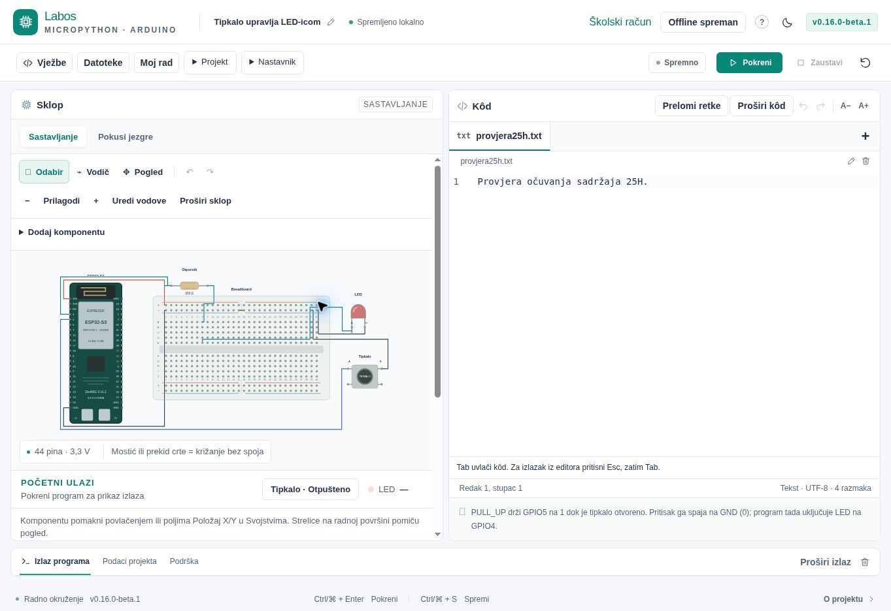

# Labos 0.16.0-beta.1 — potvrđena javna objava

Datum: 20. studenoga 2026. (Europe/Zagreb).

- Adresa: https://zljix.github.io/labosv2/
- Objavljeni commit: `7a0de962f7a453c097b4afbd9d17ae592bec6064`.
- Build javnog paketa: `4abe6bca6d24bb89`; putanja `/labosv2/`.
- Pages izgradnja i objava: uspjeh, https://github.com/zljix/labosv2/actions/runs/44651691546 .
- Dokazi prihvata: artifact `14592175257`, SHA-256 ZIP-a `4662e2fe70d4c69944b3e2a69dc92ae6b1514b32b00fd72b52a8b2297e1123df` (čuva se 30 dana).
- Prethodna verzija: `0.14.15-beta.2`, sačuvana na `backup/pre-0.16.0-e5e6529`.

## Provjera

159 automatskih testova prošlo je bez pogrešaka. Četiri testa zasebnog Arduino CLI alata preskočena su jer taj alat nije instaliran u Pages poslu; novi WASM prevoditelj zasebno je izgrađen i testiran.

CI Chromium potvrdio je nadogradnju starog profila kroz gumb „Spremi i otvori novu verziju”, očuvanje oba projekta, aktivnog projekta, lokalnih podataka i nepovezane predmemorije. Predmemorija nije brisana. U zasebnom Linux mrežnom prostoru, bez uporabljivih mrežnih sučelja, izmijenjen je izvor, preveden i pokrenut program, provjereni su izvoz/uvoz i odbacivanje starog rezultata nakon sintaksne pogreške. Nakon potpunog restarta preglednika preveden je još jedan novi izvor. Provjeren je prikaz na 390 px i na desktopu. Nije bilo pogrešaka stranice.

Dodatno je na stvarnoj javnoj adresi postojeći preglednik nadograđen s 0.14.15-beta.2 na 0.16.0-beta.1 bez čišćenja. Projekt „Tipkalo upravlja LED-icom” i datoteka `provjera25h.txt` ostali su sačuvani.

## Distribucija

Detalji i izvori: https://zljix.github.io/labosv2/compiler-sources.html . Komponente zadržavaju svoje licence. Model pristupa pripadajućim izvorima prema GPLv3 §6(d) opisan je u `DISTRIBUTION.md`; održavanje dostupnosti izvora ostaje obveza distributera. Točne upstream skripte izgradnje povezane su kod autora i nisu prepakirane ni proglašene MIT kodom Labosa. Sačuvane su licence te dodane Emscripten, musl i LLVM runtime obavijesti.

Javna arhiva `labos-corresponding-source.tar.gz` preuzeta je i provjerena: 9.963.140 bajtova, SHA-256 `bd8d5b025862856e948db52b2ef9e32e2c5bbebac76e6223cbbd7cc8addb357b`.

## Granice potvrde

Ovo je eksperimentalna beta Uno/Nano prevoditelja u pregledniku. Fizički školski i5-6600 / 8 GB, Android i iPhone nisu potvrđeni pilotom. ESP32-S3 offline C++, programiranje fizičkih pločica i službeno bodovanje nisu dio ove nadogradnje.

Zasebna opsežna provjera školskog PHP/MySQL izdanja (run 44651691410) još je bila u tijeku pri pisanju ovoga zapisa; ne prikazuje se kao uspješno završena. Javni Pages paket prošao je svoje obvezne provjere i objavljen je.

Prvi pokušaj Pages provjere zaustavljen je zbog dvosmislenog selektora gumba u testnoj skripti. Selektor je ispravljen, a cijela izgradnja i prihvat zatim su uspješno ponovljeni. Aplikacijski kod zbog toga nije mijenjan.
